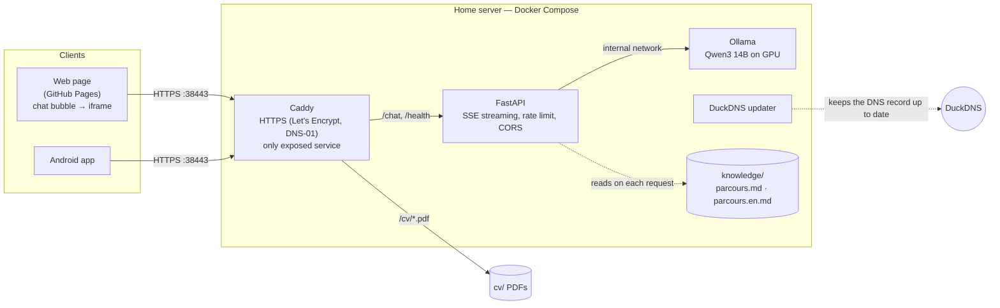

# Recruiter Chatbot — self-hosted AI assistant about my background

[](https://github.com/Wardmisp/recruiter-chatbot/actions/workflows/pages.yml)


**Live demo: [wardmisp.github.io/recruiter-chatbot](https://wardmisp.github.io/recruiter-chatbot/)** — click the chat bubble.

> 🇫🇷 **En bref** — Un assistant IA qui répond aux questions des recruteurs sur mon parcours, en français
> ou en anglais, **uniquement à partir de mon CV**. Le modèle de langage open-source (Qwen3 14B) tourne sur
> mon propre PC (GPU), derrière une API FastAPI en streaming et un reverse proxy Caddy en HTTPS.
> Le client est une application **Kotlin Multiplatform / Compose Multiplatform** : la même interface
> tourne sur **Android** et dans le **navigateur** (WebAssembly, avec repli JavaScript).

---

## What it does

Recruiters can ask questions such as *"What is his experience with Jetpack Compose?"*,
*"Is he open to remote work?"* or *"Quand est-il disponible ?"* and get an answer that is streamed
token by token.

- **Grounded answers only** — the model answers exclusively from a Markdown knowledge file
  ([`knowledge/parcours.md`](knowledge/parcours.md) / [`parcours.en.md`](knowledge/parcours.en.md)).
  Anything not in it is reported as *not available*, with a pointer to my contact details.
- **French or English**, following the language of the question.
- **One shared UI, three targets** — Android, WebAssembly and JavaScript, from the same Kotlin code.
- **Fully self-hosted, open-source stack** — no third-party AI API: the LLM runs on my own GPU.

## Architecture



Only Caddy publishes a port. Ollama and FastAPI are reachable solely through the internal Docker
networks. The home router forwards an external high port to Caddy, and the TLS certificate is obtained
through a **DNS-01 challenge** because ports 80/443 are not reachable from the Internet.

## Tech stack

| Layer | Technologies |
|---|---|
| **Client (shared)** | Kotlin 2.4, Kotlin Multiplatform, Compose Multiplatform 1.12 (Material 3), Ktor client 3.6, kotlinx.serialization, kotlinx.coroutines / `StateFlow`, multiplatform `ViewModel`, Compose resources (FR/EN strings) |
| **Client targets** | Android (OkHttp engine) · WebAssembly + JavaScript fallback (fetch engine), built with `composeCompatibilityBrowserDistribution` |
| **Backend** | Python, FastAPI, Server-Sent Events, httpx (async streaming to Ollama), slowapi (per-IP rate limiting), pydantic-settings |
| **LLM** | Ollama, Qwen3 14B (Q4), thinking mode, runs on an NVIDIA RTX 5080 (16 GB VRAM) |
| **Infrastructure** | Docker Compose, Caddy 2 built with `caddy-dns/duckdns` (xcaddy), Let's Encrypt DNS-01, DuckDNS dynamic DNS |
| **Web page** | Static HTML/CSS/JS, dependency-free chat widget, light/dark themes |
| **CI/CD** | GitHub Actions: shared-code tests, web build, deployment to GitHub Pages |

## Notable design choices

**Keeping the model honest.** The system prompt restricts answers to the knowledge file and forbids
linking a technology to an experience unless the text explicitly does so. A short reminder is appended
as the *last* message of the conversation, where a 14B model follows it much more reliably. Qwen3's
thinking mode is enabled: it adds a few seconds before the first token but removes the hallucinations
observed without it (e.g. answering "yes" to "has he used KMP professionally?").

**Language handling on the server.** Instead of asking the model to translate a French background on
the fly, the API detects whether the question is French or English (a lightweight function-word
heuristic, falling back to earlier messages, then French) and sends the knowledge file **in that
language**, with a reminder in that language.

**Streaming end to end.** FastAPI relays Ollama's tokens as SSE events (`thinking`, `token`, `done`,
`error`); Caddy flushes them without buffering; the Kotlin client parses the stream line by line with a
small, unit-tested `SseParser` and updates a `StateFlow` consumed by Compose.

**Defensive API.** Per-IP rate limiting, message-size and history limits, a request-body cap in Caddy, a
generation timeout, a concurrency limit (HTTP 503 `busy` beyond it), CORS restricted to the site origin,
and logs that never contain IP addresses or message contents.

**A widget that costs nothing until it is used.** The Compose app weighs a few megabytes (Skiko
rendering engine), so the page only loads a 5 KB script. The app is loaded in an `<iframe>` on the
first click, which also isolates it from the host page's styles. On phones, the panel is full screen.

**Configuration over code.** Every limit, the model tag, the allowed origins and the domain come from
environment variables (`.env`, never committed). The knowledge file is re-read on each request, so the
assistant can be updated without restarting anything.

## Repository layout

```
.
├── api/                    FastAPI backend (SSE chat, /health, prompt construction)
│   └── app/                config.py · main.py · prompt.py
├── caddy/                  Caddy image with the DuckDNS plugin + Caddyfile
├── duckdns/                Dynamic DNS updater script
├── knowledge/              Background in Markdown (FR + EN) — the model's only source
├── cv/                     Public resume PDFs, served by Caddy under /cv/
├── client/                 Kotlin Multiplatform project
│   ├── shared/             Shared code: Ktor client, SSE parser, ViewModel, Compose UI, tests
│   ├── androidApp/         Android entry point
│   └── webApp/             Web entry point (Wasm + JS)
├── site/                   GitHub Pages: presentation page + chat-widget.js
├── .github/workflows/      Tests, web build and Pages deployment
├── docker-compose.yml
└── .env.example            All settings, documented (copy to .env)
```

## Running it

### Server

Requirements: Docker with NVIDIA GPU support, a DuckDNS subdomain, and a router that forwards an
external port to port 443 of the machine.

```bash
cp .env.example .env              # then fill in DOMAIN, DUCKDNS_TOKEN, ALLOWED_ORIGIN…
docker compose up -d --build
docker compose exec ollama ollama pull qwen3:14b
curl https://<your-domain>:<external-port>/health   # {"status":"ok"}
```

To change what the assistant knows, edit `knowledge/parcours.md` **and** `knowledge/parcours.en.md`;
changes apply to the next question.

### Client

Requirements: JDK 17+ (Gradle provisions the JDK 21 daemon automatically) and the Android SDK.

```bash
cd client
./gradlew :androidApp:installDebug                          # Android device or emulator
./gradlew :webApp:wasmJsBrowserDevelopmentRun               # web, http://localhost:8080
./gradlew :webApp:composeCompatibilityBrowserDistribution   # production web build (Wasm + JS)
./gradlew :shared:testAndroidHostTest                       # unit tests
```

For local web development, add `http://localhost:8080` to `ALLOWED_ORIGIN` on the server.

### Embedding the chat bubble on another page

```html
<script src="https://wardmisp.github.io/recruiter-chatbot/chat-widget.js" defer></script>
```

The page can also open the panel from its own buttons with `window.RecruiterChat.open()`.

## About

Built by **Rémi Mialon-Evan**, Mobile Engineer — Android / Kotlin
([LinkedIn](https://www.linkedin.com/in/r%C3%A9mi-mialonevan-b0a388174) ·
[GitHub](https://github.com/Wardmisp)), with the assistance of
[Claude Code](https://claude.com/claude-code) as an agentic development tool.
